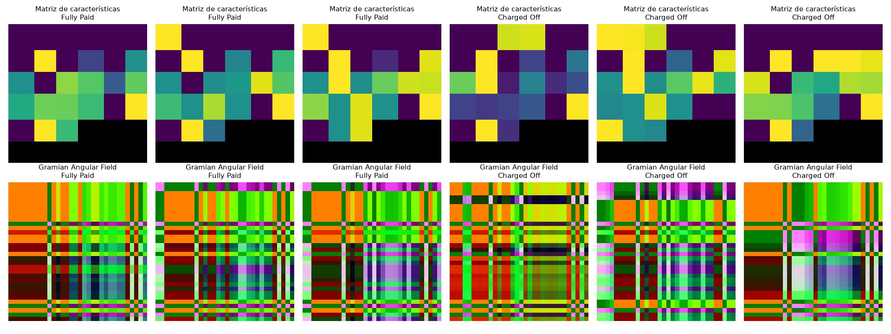
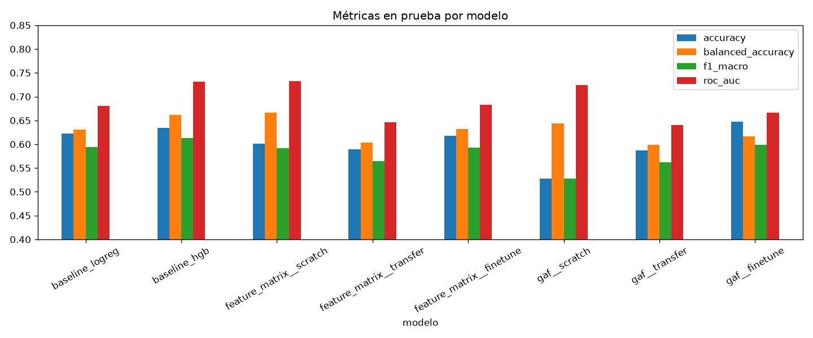
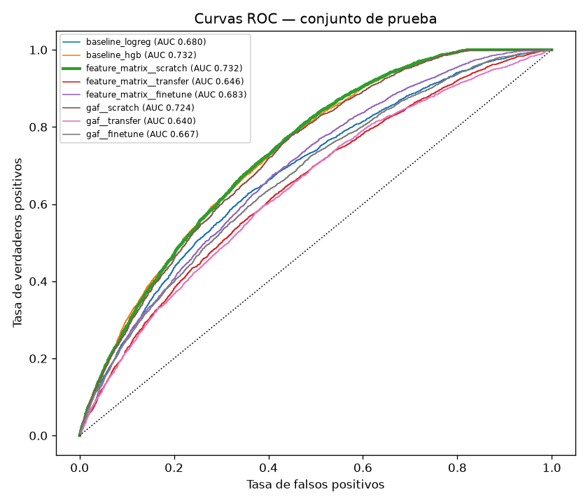
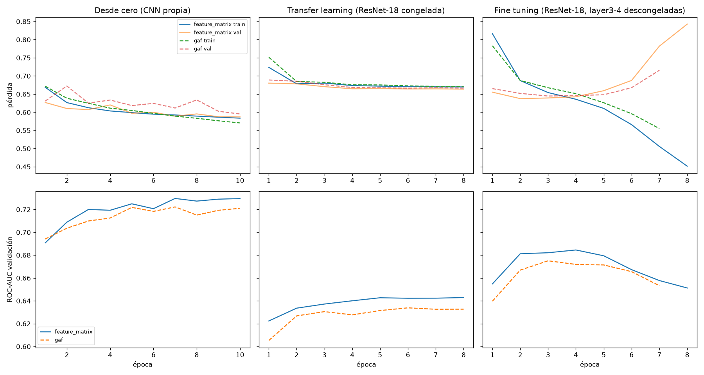
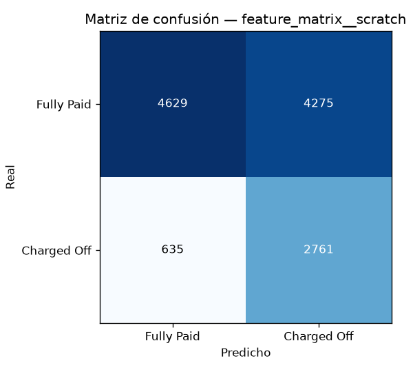

# Informe técnico: clasificación de clientes bancarios mediante representación visual y Deep Learning

**Parcial 4 — Integrantes:** Jhon Gómez, Laura y Miguel Arango

## 1. Resumen

Este proyecto clasifica clientes del dataset Bank Loan en dos clases: *Fully Paid* (el préstamo se paga) y *Charged Off* (el préstamo se incumple). Como los datos son tabulares, cada cliente se transforma en una imagen mediante dos estrategias de representación visual —una **matriz de características** y un **Gramian Angular Field (GAF)**— y cada representación se clasifica con tres esquemas de Deep Learning: una CNN entrenada **desde cero**, **transfer learning** con ResNet-18 preentrenada en ImageNet y **fine tuning** de la misma red. Se entrenaron seis modelos, se compararon con métricas adecuadas para clases desbalanceadas y el mejor se integró en una aplicación Streamlit que evalúa nuevos clientes, muestra su imagen, la predicción y el nivel de confianza.

El mejor modelo fue la **matriz de características con una CNN entrenada desde cero**: ROC-AUC de 0,732, accuracy balanceada de 66,6 % y F1 macro de 0,591 en el conjunto de prueba, con un recall de 81,3 % sobre los clientes que incumplen. Su desempeño es equivalente al de un modelo tabular de gradient boosting usado como referencia (ROC-AUC 0,7316).

## 2. Dataset y preparación

El archivo `credit_train.csv` contiene 100.514 filas y 19 columnas: identificadores (`Loan ID`, `Customer ID`), la etiqueta `Loan Status` y 16 variables del préstamo y del historial crediticio. El archivo `credit_test.csv` (10.353 filas) no trae etiqueta y se usa para simular clientes nuevos en la aplicación.

**Limpieza**

- Se eliminaron 514 filas completamente vacías y los registros repetidos por `Loan ID` (≈18.500), quedando **81.999 clientes**.
- `Current Loan Amount = 99999999` es un valor centinela (no un monto real); se trató como faltante.
- Algunos `Credit Score` aparecen multiplicados por 10 (por ejemplo 7120); los valores mayores a 850 se dividieron entre 10.
- Distribución de clases: 72,4 % *Fully Paid* y 27,6 % *Charged Off*.

**Ingeniería de variables (27 variables)**

- Numéricas originales, con logaritmo en las monetarias: monto, ingreso anual, deuda mensual, saldo y crédito máximo.
- Puntaje de crédito, años de empleo (convertido a número), años de historial, cuentas abiertas, problemas de crédito, bancarrotas y gravámenes.
- Meses desde la última mora, con un indicador `never_delinquent` cuando el valor falta.
- Razones derivadas: deuda/ingreso (`debt_to_income`), utilización del crédito (`credit_utilization`) y préstamo/ingreso (`loan_to_income`); indicador de ingreso faltante.
- Codificación one-hot del plazo, el tipo de vivienda (3 grupos) y el propósito (5 grupos).

Los faltantes se imputan con la mediana de entrenamiento y cada variable se lleva a [0, 1] con `QuantileTransformer` (distribución uniforme), ajustado solo con el conjunto de entrenamiento. La partición es estratificada: **70 % entrenamiento (57.399), 15 % validación (12.300) y 15 % prueba (12.300)**.

## 3. Representaciones visuales

Ambas representaciones se implementan en PyTorch (`src/representations.py`) y se generan por lotes directamente en la GPU durante el entrenamiento. El orden de las variables se obtiene con clustering jerárquico (enlace promedio) sobre la distancia 1 − |correlación|, de modo que las variables relacionadas queden contiguas.

1. **Matriz de características.** Las 27 variables ordenadas se ubican en una cuadrícula de 6 × 6 (las 9 celdas sobrantes quedan en negro). Cada celda se colorea con el mapa *viridis* según su valor. La vecindad espacial de variables correlacionadas genera patrones locales que una CNN puede aprovechar.
2. **Gramian Angular Field.** Cada valor x ∈ [0, 1] se codifica como ángulo φ = arccos(2x − 1) y se construye una imagen de 27 × 27 con tres canales: GASF = cos(φᵢ + φⱼ), GADF = sin(φᵢ − φⱼ) y el producto xᵢ·xⱼ. Cada píxel describe la interacción entre un par de variables.

Las dos imágenes se reescalan a 32 × 32 píxeles por vecino más cercano (no se pierde información porque sus tamaños nativos son 6 × 6 y 27 × 27) y se normalizan con la media y desviación de ImageNet.



## 4. Arquitecturas y entrenamiento

| Esquema | Arquitectura | Parámetros entrenables | Entrenamiento |
|---|---|---:|---|
| Desde cero | CNN propia: 4 bloques Conv3×3-BatchNorm-ReLU-MaxPool (32-64-128-128 filtros), global average pooling, dropout 0,3 y capa lineal | 241.442 | AdamW, lr 2·10⁻³, hasta 10 épocas |
| Transfer learning | ResNet-18 preentrenada en ImageNet con backbone congelado (incluida BatchNorm); se entrena solo la nueva cabeza (dropout + lineal) | 1.026 | AdamW, lr 3·10⁻³, hasta 8 épocas |
| Fine tuning | Parte del modelo de transfer learning ya entrenado y descongela `layer3`, `layer4` y la cabeza | 10.494.466 | AdamW, lr 3·10⁻⁴, hasta 8 épocas |

Configuración común: lotes de 1.024 imágenes, entropía cruzada ponderada por clase (pesos inversos a la frecuencia) para compensar el desbalance, decaimiento coseno de la tasa de aprendizaje, *weight decay* 10⁻⁴ y parada temprana con paciencia 4 sobre el ROC-AUC de validación, restaurando los mejores pesos. Semilla fija (42). Hardware: GPU NVIDIA GTX 1650 (4 GB).

Como **referencia** se entrenaron dos modelos tabulares sobre las mismas 27 variables: regresión logística y `HistGradientBoostingClassifier`, ambos con pesos balanceados.

**Criterio de selección:** mayor ROC-AUC en validación (desempate por F1 macro). Las métricas de prueba se reportan para la comparación final, no para escoger el modelo. Se reportan accuracy, accuracy balanceada, precisión, recall y F1 de la clase *Charged Off*, F1 macro y ROC-AUC. El accuracy por sí solo no es adecuado: un clasificador que siempre predice *Fully Paid* obtendría 72,4 %.

## 5. Resultados

**Validación** (criterio de selección). CO = clase *Charged Off*.

| Modelo | Accuracy | Acc. balanceada | Precisión CO | Recall CO | F1 CO | F1 macro | ROC-AUC |
|---|---:|---:|---:|---:|---:|---:|---:|
| Ref. tabular — Regresión logística | 62,3 % | 62,8 % | 38,8 % | 63,9 % | 48,3 % | 0,593 | 0,678 |
| Ref. tabular — HistGradientBoosting | 63,6 % | 66,2 % | 41,0 % | 72,0 % | 52,2 % | 0,614 | 0,726 |
| **Matriz de características — Desde cero** | 60,0 % | 66,3 % | 39,1 % | 80,4 % | 52,6 % | 0,590 | **0,730** |
| Matriz de características — Transfer learning | 59,2 % | 60,5 % | 36,3 % | 63,3 % | 46,2 % | 0,567 | 0,643 |
| Matriz de características — Fine tuning | 61,7 % | 62,7 % | 38,5 % | 64,8 % | 48,3 % | 0,589 | 0,685 |
| GAF — Desde cero | 52,1 % | 63,7 % | 35,5 % | 89,8 % | 50,9 % | 0,520 | 0,722 |
| GAF — Transfer learning | 58,3 % | 59,6 % | 35,5 % | 62,7 % | 45,3 % | 0,558 | 0,634 |
| GAF — Fine tuning | 65,3 % | 62,0 % | 40,5 % | 54,6 % | 46,5 % | 0,604 | 0,675 |

**Prueba** (12.300 clientes no usados en el entrenamiento ni en la selección).

| Modelo | Accuracy | Acc. balanceada | Precisión CO | Recall CO | F1 CO | F1 macro | ROC-AUC |
|---|---:|---:|---:|---:|---:|---:|---:|
| Ref. tabular — Regresión logística | 62,2 % | 63,1 % | 39,0 % | 65,0 % | 48,7 % | 0,594 | 0,680 |
| Ref. tabular — HistGradientBoosting | 63,4 % | 66,1 % | 40,8 % | 72,1 % | 52,1 % | 0,613 | 0,732 |
| **Matriz de características — Desde cero** | 60,1 % | 66,6 % | 39,2 % | 81,3 % | 52,9 % | 0,591 | **0,732** |
| Matriz de características — Transfer learning | 58,9 % | 60,4 % | 36,1 % | 63,7 % | 46,1 % | 0,564 | 0,646 |
| Matriz de características — Fine tuning | 61,8 % | 63,2 % | 38,8 % | 66,3 % | 49,0 % | 0,592 | 0,683 |
| GAF — Desde cero | 52,8 % | 64,4 % | 35,9 % | 90,3 % | 51,4 % | 0,527 | 0,724 |
| GAF — Transfer learning | 58,7 % | 59,9 % | 35,8 % | 62,5 % | 45,6 % | 0,562 | 0,640 |
| GAF — Fine tuning | 64,7 % | 61,6 % | 39,8 % | 54,7 % | 46,1 % | 0,599 | 0,667 |

**Costo de entrenamiento**

| Modelo | Parámetros entrenables | Épocas | Tiempo (s) |
|---|---:|---:|---:|
| Matriz de características — Desde cero | 241.442 | 10 | 432 |
| Matriz de características — Transfer learning | 1.026 | 8 | 39 |
| Matriz de características — Fine tuning | 10.494.466 | 8 | 272 |
| GAF — Desde cero | 241.442 | 10 | 53 |
| GAF — Transfer learning | 1.026 | 8 | 41 |
| GAF — Fine tuning | 10.494.466 | 7 | 70 |









**Análisis**

- **Modelo seleccionado: matriz de características + CNN desde cero.** Obtuvo el mayor ROC-AUC de validación (0,730) y en prueba alcanzó ROC-AUC 0,732, accuracy balanceada 66,6 % y F1 macro 0,591. Detecta el 81,3 % de los clientes que incumplen (recall *Charged Off*), a costa de una precisión de 39,2 %: marca como riesgosos a varios clientes que sí pagan. Por eso su accuracy (60,1 %) es menor que la proporción de la clase mayoritaria; el modelo está orientado a no dejar pasar incumplimientos, efecto de la pérdida ponderada.
- **Desde cero > fine tuning > transfer learning en ambas representaciones.** Las imágenes generadas (cuadrículas de colores y matrices de Gram) no se parecen a las fotografías de ImageNet, así que las características congeladas de ResNet-18 transfieren poco (ROC-AUC ≈ 0,64 con solo 1.026 parámetros entrenables). Descongelar `layer3`–`layer4` mejora a ≈ 0,67–0,68, pero no alcanza a la CNN pequeña entrenada específicamente para estas imágenes, que además tiene 43 veces menos parámetros que el fine tuning.
- **Matriz de características vs GAF.** Con el mismo esquema la matriz de características fue ligeramente mejor (0,732 vs 0,724 en prueba desde cero; 0,683 vs 0,667 con fine tuning). El GAF desde cero tuvo un recall muy alto (90,3 %) pero accuracy baja (52,8 %), es decir, un punto de corte menos equilibrado.
- **Comparación con modelos tabulares.** La mejor CNN igualó al HistGradientBoosting (ROC-AUC 0,7325 vs 0,7316) y superó a la regresión logística (0,680). La representación visual permite aplicar Deep Learning y produce una imagen interpretable de cada cliente, pero no supera de forma clara a un buen modelo tabular. Es esperable en datos tabulares con señal moderada, donde ningún modelo pasa de ≈ 0,73 de ROC-AUC.
- **Curvas de entrenamiento.** La pérdida de validación acompaña a la de entrenamiento sin separarse, por lo que no hay sobreajuste marcado; el ROC-AUC se estabiliza tras 5–7 épocas.

## 6. Aplicación desarrollada

La aplicación (`app.py`, Streamlit) carga el modelo seleccionado (`models/best_model.pt`), el preprocesador ajustado (`models/preprocessor.joblib`) y los metadatos (`models/model_info.json`). Se ejecuta con `streamlit run app.py`.

- **Entrada:** formulario lateral con los 16 campos originales del cliente (plazo, monto, puntaje de crédito, ingreso, años de empleo, vivienda, propósito, deuda mensual, historial, mora, cuentas, saldo, crédito máximo, bancarrotas y gravámenes). El botón *Cargar cliente aleatorio* toma un registro de `credit_test.csv`, que el modelo nunca vio.
- **Procesamiento:** aplica la misma limpieza, ingeniería de variables y normalización del entrenamiento, y genera la imagen del cliente.
- **Salida:** la representación visual que recibe la red, la clase predicha (*Fully Paid* / *Charged Off*), el **nivel de confianza** (probabilidad softmax de la clase predicha) con barra de progreso y gráfico de probabilidades de ambas clases. Además permite ver la otra representación y las variables transformadas.


## 7. Conclusiones y posibles mejoras

- Es posible clasificar clientes bancarios convirtiendo cada registro tabular en una imagen. Las dos representaciones probadas funcionaron y la **matriz de características ordenada por correlación** dio los mejores resultados.
- Para estas imágenes sintéticas, una **CNN pequeña entrenada desde cero** superó a ResNet-18 con transfer learning y con fine tuning: el conocimiento de ImageNet no se transfiere bien a imágenes que no representan objetos naturales.
- El modelo seleccionado alcanza ROC-AUC 0,732 y detecta 8 de cada 10 clientes que incumplen. Su desempeño es equivalente al de gradient boosting sobre la tabla, por lo que el aporte del enfoque visual está más en la representación interpretable de cada cliente y en la posibilidad de usar arquitecturas de visión que en una ganancia de exactitud.
- La aplicación permite evaluar clientes nuevos de forma sencilla, mostrando la imagen que ve la red, la predicción y su nivel de confianza.

**Posibles mejoras**

1. Probar representaciones que aprenden la ubicación de las variables en el plano, como **DeepInsight** (t-SNE/kernel PCA) o **IGTD**, y combinar varias representaciones como canales de una misma imagen.
2. **Ajustar el umbral de decisión** según el costo de negocio: no detectar un incumplimiento suele costar más que rechazar a un buen cliente.
3. **Calibrar las probabilidades** (Platt o regresión isotónica) para que el nivel de confianza sea interpretable como probabilidad real.
4. Validación cruzada y búsqueda de hiperparámetros (tamaño de imagen, tasa de aprendizaje, épocas, descongelamiento progresivo de capas).
5. Ensamble entre la CNN y el modelo tabular de gradient boosting.
6. Explicabilidad: mapas de activación (Grad-CAM) sobre la imagen para indicar qué variables influyeron en la decisión.

## 8. Reproducción

```
pip install -r requirements.txt
python train.py
streamlit run app.py
```

`train.py` regenera `results/metricas.csv`, `results/historial.json`, las figuras de `results/figures/` y el modelo de `models/`. El notebook `parcial4_bank_loan.ipynb` documenta la exploración, las representaciones, los resultados y la prueba del modelo (con `RETRAIN = True` vuelve a entrenar).
